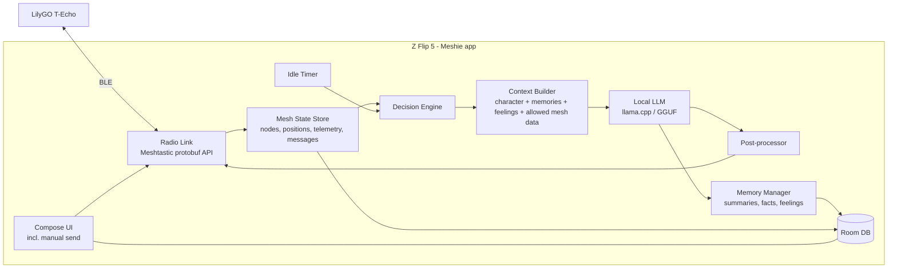

# Meshie (formerly Meshtastic-chan) — Design Document (v0.2)

An Android app that turns a dedicated phone + LilyGO T-Echo into an AI mesh user.
It reads every message on its operating channel (LongFast by default) and DMs,
decides whether it would naturally join in, and replies as a configurable
character. It remembers people, has feelings about them, and keeps the chat alive
during live events (concerts, conventions).

---

## 0. Decisions log

| # | Topic | Decision |
|---|---|---|
| D1 | Radio link | App owns the T-Echo BLE connection directly. It replaces the official Meshtastic app on the bot phone. |
| D2 | Hardware | Samsung Galaxy Z Flip 5 (Snapdragon 8 Gen 2, 8 GB RAM), dedicated bot phone. LilyGO T-Echo radio. |
| D3 | Model | User picks any model in-app. No hard-coded choice. App warns when a model likely won't fit in RAM. |
| D4 | Characters | One active character at a time. Each character defines its mesh long/short names. Multiple active = future. |
| D5 | Memory scope | Memories, summaries and feelings are shared by all characters. Per-character memory = future. |
| D6 | Feelings | Free-text line per user (e.g. "hopelessly in love", "a bit annoyed"), model-editable unless locked. |
| D7 | Rate limiting | None needed (~20 msgs/hour on the channel). Only a bot-loop guard. No quiet hours, no day-scale waits. **Superseded by D54.** |
| D8 | Modes | Observe, Approve, Auto all available. Plus **Sleep** ("put to bed") for a chosen duration. |
| D9 | Manual send | Operator can send messages as the character from the app (channel or DM). |
| D10 | Idle chatter | If the channel is idle for a configurable time, the character starts a conversation. |
| D11 | Mesh data | Focus on fun stuff, mainly near/far distance. All data is pre-computed into the prompt (no tool calls). Every field is individually toggleable in Settings. |
| D12 | Channels | Operating channel = LongFast by default; can be switched to any channel on the device (incl. private) in Settings. DMs always handled. |
| D13 | LLM runtime | llama.cpp vendored (plain folder), CPU only, 4 threads. "Fast weights" (repack) on by default but auto-off for models > 30% of RAM, otherwise lmkd kills the app. |
| D14 | Thinking models | Reasoning is disabled for templates that support `enable_thinking` (empty think block pre-filled); replies must be short and fast. |
| D15 | Bag mode | Primary use is screen off in a bag. Samsung confines us to 3 little cores then, so: threads capped to allowed CPUs, KV prefix cache reuse, prompts must be append-only (static parts first, newest message last). Llama 3.2 1B recommended for screen-off; 3B usable but slow. |
| D16 | Text-only sandbox | The model has no tools. Its output is only ever (a) shown in the UI, (b) sent as mesh text after post-processing, or (c) parsed for fixed, validated fields (judge JSON, later feelings/memories). It never controls admin messages, files, network, settings or other apps. See section 10. |
| D17 | Uncensored models | Abliterated variants are offered so shitposting isn't blocked by refusals. Persona/rules set the tone; prompt protections are worded as character guidance (refusal-style wording made small models refuse). |
| D18 | Full prompt control | Every prompt the model sees (system, reply, judge, idle, review, memory) is an editable template (`brain/PromptTemplate.kt`, Persona tab) with `{placeholders}` and `{#key}…{/key}` blocks. Defaults are neutral: no radio/mesh/signal framing, since the field test showed that framing leaks into every reply. Unwanted words go in a per-character "Never say" list (checked in code), not in negative prompt rules (those primed the word). |
| D19 | Rolling context | The model only sees the last N messages within the last M minutes, and nothing before the last "Fresh start" (also set by memory wipes). Her own lines are labelled "Name (you)". She never replies when she spoke last or nothing new arrived since her last message. |
| D20 | Output checks | Up to 3 attempts per reply; reject refusals, "Never say" hits, repeats of her recent lines, and copies of 5+ word runs from the context. Optional second model pass (review) judges the draft in character before sending. The operator's manual messages are used as style examples ("learn from my messages"). |
| D21 | Idle without monologue | Idle chatter fires once after the channel has been quiet for the idle time, and not again until someone else speaks. |
| D22 | Chan page | Home tab is a Pokédex-style page: chibi drawn in code (face follows dominant mood), mood word cloud from keyword scores of her sent messages (1 h half-life), counts, besties, idle countdown and "Propose a thought" (generate, edit, send). |
| D23 | Adults only | Every character and every chat is treated as adult. The default system prompt says "a group chat with adults" (no mention of radio, which made models act like radio hosts). When a model refuses anyway, the Feed shows the model's own words plus a plain-language guess at the trigger. |
| D24 | Fully offline | Nothing but model downloads touches the internet. The BLE link must survive Bluetooth off/on and out-of-range timeouts without an app restart. |
| D25 | On/off | Besides timed sleep (any number of minutes/hours), a switch turns her off with no timer: no replies, idle chatter or memory passes; still listens and logs. |
| D26 | Forgetting | Erasing memory marks that chat as already processed and starts a fresh context, so the memory pass can't relearn it from the log and replies can't "remember" it from recent chat. |
| D27 | Location privacy | Only the radio's GPS is ever used, never the phone's. "Use my radio's GPS" is a master switch, off by default; everything that reveals where we are depends on it. |
| D28 | Approaching / leaving | Opt-in twice over: a data field for the model's context, and a behavior that posts once when someone comes within 300 m (2 h cooldown per person). Built from a 3 h radio position history. |
| D29 | Unattended running | Foreground service starts after reboot/app update; the notification shows character, mode/off/asleep and what she's doing; a watchdog reloads a failed/unloaded model (backoff 1/2/5/15 min) and cancels generations running over 5 min; the home page warns while battery optimisation is on. |
| D30 | Favorites | Any message (anyone's) can be starred by long-press in the Feed or a DM. "From favorites" on the Chan page picks a random 1–5 of them (each with the message it answered), raises temperature by 0.25 for variety, and asks for a new message in that spirit; copying a favorite is rejected. |
| D31 | Personas on the Chan page | No separate Persona tab. The Chan page is a swipeable Pokédex of personas (each with its own hair colour; last page creates a new one) with Make active / Edit / Delete, followed by the shared bot settings (event notes, memories, behavior, templates, data access, prompt preview). |
| D32 | Default model | Dolphin 3.0 Llama 3.2 1B: the only small model that never refused across replies, idle chatter and favorites with crude personas. |
| D33 | Full reset | One button clears everything the model could carry over: memories/summaries/feelings, earlier chat and past manual messages (hidden via reset timestamps), favorites, position history, and the prompt cache (model reload). Only what the operator wrote (persona, rules, examples, event notes, templates) remains. |
| D34 | Idle source | Automatic idle messages come from a plain thought, from favorites, or a random mix (chosen on the Chan page); favorites fall back to a thought when none are starred. The timer names the active persona. |
| D35 | No "shitpost" models | Models trained specifically for shitposting are either tiny (10–40M params, can't follow a persona) or trained on 4chan archives (hate speech). Use persona-following uncensored fine-tunes instead. |
| D36 | Prompt visibility | The prompt preview shows every prompt kind (reply, judge, idle, favorites, arrival, review, memory) and the raw text after the model's chat template; nothing else is sent. All fixed wording inside the data lines (labels, "(you)", person alias, surroundings sentences) is an editable phrase; an empty phrase drops that line. |
| D37 | Pronouns | Each persona has pronouns (she/he/they/it). UI text and templates use them ({they} {them} {their} {themself}); no persona name or pronoun is hardcoded. |
| D38 | Stat detail pages | Base stats count since the last full reset. Each one opens a detail page (messages with summary + star, people ranked, facts/feelings/memories that open the person's Memory tab). "Heard" and "stayed quiet" are plain numbers. |
| D39 | Chibi creator | Each persona's look is a layered avatar (body, skin, hair, eyes, face, ears, hat, outfit, extras, free colours) stored as JSON in `characters.avatar`; presets + randomize; the mood still drives the expression. Empty = classic look in the pager colour. New personas start with a random look. |
| D40 | Callout mode | Optional (Next thought card): idle chatter and proposed thoughts are aimed at a random person heard over the radio (not MQTT, not ignored) in the last hour, by name. Needs Long or Short name access. If the model forgets the name, it's prefixed. The prompt line is the editable CALLOUT phrase. |
| D41 | Acting on observed replies | Observed replies in the Feed can be sent later ("Send now") or starred. Starred unsent replies count as favorites (shown as "(unsent)"; cleared by full reset). DB v12. |
| D42 | Context weighting | Small models weigh the start and end of the prompt most and copy concrete examples over abstract descriptions. So: persona is the first thing in the system prompt, and a short persona reminder (editable phrase) is the last line of every request; learned style examples are capped at 3 and labelled "style, not topics"; the message being answered appears once, at the end; earlier chat is labelled background, only the newest 2 lines stay whole (older ones cut to 80 chars); only the person being answered gets details (max 3 facts); self-memories max 5; default history 6 messages. |
| D43 | Persona strength (CFG) | Classifier-free guidance on persona: each token is sampled from `neg + s·(pos − neg)` where neg is the same prompt with the persona and reminder removed (second llama context, created lazily, own KV prefix cache). Behavior slider 1–3, default 1.5. Idle test, persona "the aliens are attacking!": 1.0 → ~5/12 on-persona, 1.5 → ~10/12 and varied, 2.0 → 12/12 but repetitive openers. Not applied to judge/review (grammar calls). |
| D44 | Settings tab | Bottom bar: Chan / Feed / People / Settings. Settings has three sections: Models (active model, generation settings, catalog, downloads), Context (event notes, memory, behavior, templates and phrases, data access) and Radio (connection, background, radio name, channel). The prompt preview stays on the Chan page next to the persona it shows. Supersedes the settings half of D31. |
| D45 | Brainstorm | The Next thought card has a private operator ↔ persona chat (BRAINSTORM template added to the system prompt; recent group chat as background; persona strength applies). Nothing in it is sent. Any reply can become the post ("Use as the post"), or "Write the post" asks for the group message (BRAINSTORM_POST phrase) and runs it through every normal check. Event notes and Memory live on the Chan page; Settings → Context keeps behavior, templates and data access. |
| D46 | Message notifications | Incoming DMs (channel "Direct messages", high importance) and channel messages ("Channel messages", default) notify as MessagingStyle conversations, one per DM sender / channel, last 6 lines. Not shown for what's on screen (Feed for channel messages, an open DM chat for that person) and cleared when that screen opens; ignored nodes never notify. Tapping opens the chat or the Feed. Draft-approval notifications are unchanged. |
| D47 | Pokédex scene + Organic | Each look also has a backdrop (17 drawn scenes, several animated) and a Pokédex frame colour (Scene tab in the creator; presets come with matching scenes). Tapping the chibi plays a random reaction (jump/spin/pulse/shake + face + emoji + line). "Organic" on the active card = messages said on its own / (own + sent by you), with an emoji every 15% (😡 at 0, 🤩🥇 at 100). |
| D48 | Next thought card | The card holds the same on/off switch as the Feed tab, a ⏱ button that sets the idle minutes (0 = off; the Behavior slider is gone), the source chips, a one-line callout switch and the action buttons. Brainstorm is a separate button above it. Callout targets are still limited to people heard over the radio in the last hour, but weighted: +6 if they chatted in the last hour (+3 in the last 6 h), +1 per fact (max 4), +2 for a feeling/summary, base 1. |
| D49 | Manual mode, one bot switch | The on/off switch (and "Sleep for…") lives only in the Next thought card; the Feed keeps just the mode chips and a status line. New `BotMode.MANUAL`: the brain ignores incoming messages, idle chatter and arrivals, and the Feed composer becomes a "💭 Thought" button that drafts one message with the Next thought settings (source + callout) for the operator to edit/send. |
| D50 | Persona files | "Export this persona" (editor) writes `<name>.meshchan.json` (`format: meshchan-persona`, v1): the persona fields, its avatar JSON (look, backdrop, frame), and its memories about itself (nodeNum null). Facts, feelings and summaries about mesh users are never included (and are dropped if a file has them), so personas stay portable between meshes. "Import from file" (new-persona page) adds it as a new inactive persona and adds its self-memories to the shared pool, skipping duplicates. Files over 2 MB are refused and every field is length-capped. Replaces the old memory-only export/import. |
| D51 | Opt-in welcome tour | Offered once on a fresh install (no `tutorial` setting and no personas); "Skip" or finishing records it so it never auto-shows again, and the Chan page has "Take the welcome tour again". Steps: Brain (models already on the phone first, else two curated picks: Llama 3.2 1B Uncensored, Hermes 3 3B; the user can continue while it downloads) → Create (vibe presets with persona + example lines + look, Surprise me, preset looks) → Chat (private brainstorm with starter chips) → Radio (scan/pair, explains the rename-reboot) → Go (pick mode, Observe preselected, idle minutes, bot switched on, confetti). Nothing is sent before the last step. Permissions are asked when needed (Bluetooth on the Radio step, notifications at launch) rather than at app start during the tour. `ModelManager.activate` now re-verifies unverified files on disk so models survive an app-data wipe. |
| D52 | LLM persona writer | "🪄 Let the brain write it" on the new-persona editor and the tour's Create step: a one-line idea (or none) goes through the editable `PERSONA_WRITER` template, and a GBNF grammar forces JSON `{name, short_name (2-4 alnum), pronouns, persona, things_they_would_type_in_chat[3], look}` so even 1B models answer parseably. The look is restricted to preset names, shuffled (small models pick the first option) with Classic left out. The result only fills the form; nothing is saved until the user saves. Key named `things_they_would_type_in_chat` because with `examples` the 1B wrote descriptions instead of lines in the character's voice. |
| D53 | Public release: name, license, packaging | Meshtastic's trademark policy forbids "Meshtastic" in third-party product names, so the app is shown as **Meshie** (working name). The package id `com.meshie4LoRa` is unchanged for now; changing it installs as a separate app, so rename it together with the final name. Licensed **GPL-3.0** because it bundles the GPL-3.0 Meshtastic protobufs (llama.cpp is MIT); see THIRD_PARTY_NOTICES.md. Release signing reads a git-ignored `keystore.properties`; without it the release APK is unsigned. GitHub Actions builds the debug APK and runs unit tests on every push. |
| D54 | Cooldowns and rate limit (supersedes D7) | With 3+ Meshie bots on one mesh the loop guard never fires (it only catches two nodes ping-ponging). (1) Per-person **reply cooldown** on each person's Memory tab: after answering someone, ignore them for N sec/min/hr. It's stored in its own `cooldowns` table (DB v13) so memory wipes don't drop it, measured from the last SENT/DRAFT/OBSERVED decision on one of their messages, and checked before the judge so no compute is spent. (2) **Hard rate limit** at the top of Settings → Context: at most N sent messages (ours, manual included) per window. It only holds back automatic (Auto mode) sends; a held-back reply is recorded as OBSERVED with "Send now". (3) "Wait before reacting" is now typed in sec/min/hr too. Still no quiet hours. |
| D55 | Mood word bank | Built-in mood keywords are kept neutral. Operators add their own per mood ("Word bank" on the Mood points card; comma-separated, emoji allowed). Stored in DataStore as `mood_words_<MOOD>`, global (not per persona, not in persona files), matched whole-word like the built-ins. |

---

## 1. System overview



### Tech stack

| Concern | Choice |
|---|---|
| App | Kotlin, Jetpack Compose, single `app` module, `arm64-v8a` only |
| Radio | Android BLE (Meshtastic service UUIDs), protobufs generated from `meshtastic/protobufs` (protobuf-lite) |
| LLM | llama.cpp (git submodule) built via CMake/NDK, thin JNI wrapper, GGUF models, GBNF grammar for JSON outputs |
| Storage | Room (SQLite) + DataStore for settings |
| Background | Foreground service (connectedDevice type) + partial wake lock, auto-reconnect |
| Min / target SDK | minSdk 31 (Android 12 BLE permissions), target latest stable |

---

## 2. Radio link

- Scan → pair → connect to the T-Echo over BLE (PIN pairing as configured on the device).
- Standard Meshtastic phone API: write `ToRadio`, read `FromRadio`, notify on `FromNum`.
- On connect: `want_config` → receive my node info, channels, config, node DB.
- Handled packet types: text messages, NodeInfo, Position, Telemetry (device +
  environment), routing/ack for our sends.
- On character activation: push the character's long name / short name to the
  device as the owner (`set_owner`).
- Auto-reconnect with backoff if the link drops; status shown on dashboard.

---

## 3. Model management

- **Model picker**: curated starter list of instruct GGUF models + "add by Hugging
  Face URL" + "import local file". User chooses what to run.
- Each entry shows file size, estimated RAM, and a fit indicator for this phone
  (8 GB total; realistically ~3–4 GB usable for the model before Android starts
  killing things). Bigger models are allowed with a warning.
- Download manager: resumable, checksum verify, storage usage, delete.
- Per-model settings: context length, threads, temperature, top-p, repeat
  penalty, chat template (auto from GGUF metadata, overridable).
- Benchmark button: prompt + generation tokens/sec on this phone.
- **Test chat**: talk to the active character locally without transmitting.

---

## 4. Characters

| Field | Notes |
|---|---|
| Long name | Mesh long name pushed to T-Echo (≤ 39 bytes), e.g. "Meshie" |
| Short name | Mesh short name (≤ 4 chars), e.g. "CHAN" |
| Nicknames | Extra names that count as a mention ("chan", "mesh-chan") |
| Persona prompt | Personality, backstory, speaking style |
| Example messages | Few-shot lines to anchor the voice |
| Rules | e.g. "max 2 sentences", "no emoji", language |
| Eagerness (0–100) | Bias for the respond / stay-quiet decision |
| Idle chatter prompt | Optional flavor for conversation starters (e.g. "ask about favorite bands") |
| Enabled | Exactly one character enabled at a time; enabling one disables the other |

Import / export characters as JSON.

**Event notes (global setting):** a free-text "what's happening" field
(e.g. "We're at the Riverside Jazz Fest, main stage 8 pm") injected into every
prompt so the same character can be reused across events.

*Future:* multiple active characters sharing one node.

---

## 5. Memory, summaries and feelings

All shared across characters (D5). Schema keeps a nullable `character_id` so
per-character memory can be added later without migration pain.

### Data model (simplified)

```
Node        node_num PK, user_id, long_name, short_name, hw_model, role,
            first_seen, last_seen, latest position + telemetry snapshot, ignored
Message     id, packet_id, channel, from, to, text, rx_time, rx_snr, rx_rssi,
            hop_start, hop_limit, via_mqtt, origin (MESH | BOT_AUTO | BOT_MANUAL)
Character   id, long_name, short_name, nicknames, persona, examples, rules,
            eagerness, idle_prompt, enabled
Memory      id, node_num (null = about the character / world), character_id (null = shared),
            text, source (AUTO | MANUAL), pinned, created_at, updated_at
NodeSummary node_num, rolling_summary, updated_at
Feeling     node_num, text, locked, changed_by (MODEL | USER), reason, updated_at
FeelingLog  node_num, old_text, new_text, changed_by, reason, at
Decision    message_id, respond, reason, latency_ms, at        (for the live feed)
```

### Memory types
1. **Per-user facts** — "plays bass in a local band", auto-extracted or manual.
2. **Rolling per-user summary** — a few sentences about past conversations,
   regenerated after interactions to keep prompts small.
3. **Character / world memories** — things the character knows or "did"
   (manual or auto, `node_num = null`).
4. **Message log** — recent channel history for context; retention configurable.

### Feelings (D6)
- One free-text line per user: "head over heels in love", "sad he left early",
  "mildly annoyed by the spam".
- After each interaction the memory pass may rewrite it, with a short reason.
  Changes take effect immediately (event timescale, no daily limits).
- **Lock** toggle: when locked, the model cannot change it. Editing it manually
  offers to lock in the same dialog.
- Change history shown on the user page.

### Management UI
- User page: profile, current distance, feeling (edit + lock), summary (edit),
  facts (add / edit / pin / delete), message history, "ignore this user".
- Character memory page: add / edit / pin / delete.
- Bulk clear: auto memories for a user · everything for a user · all auto
  memories · all non-pinned · wipe everything. Pinned and manual items are
  kept unless explicitly included.
- Export / import (JSON).

---

## 6. Mesh data → model context (D11)

Everything received is stored. What the model sees is controlled by
**Settings → Model data access**: one toggle per field, grouped, changeable at
any time, with a live **prompt preview** showing exactly what the model
receives for a chosen user.

| Group | Fields (default) |
|---|---|
| Identity | long name ✔, short name ✔, node id ✘, hardware model ✔, role ✘ |
| Location | proximity label ✔, distance ✔, direction ✔, approaching/leaving ✔, altitude ✘, speed ✘, raw coordinates ✘ (never sent in replies) |
| Signal | hops away ✔, SNR ✘, RSSI ✘, via MQTT ✔ |
| Device | battery ✔, voltage ✘, uptime ✘ |
| Environment | temperature ✔, humidity ✘, pressure ✘ |
| Activity | first seen ✔, last heard ✔, messages today ✔ |
| Self | own battery ✔, own location (used for distances only) ✔ |
| Mesh overview | nodes heard recently ✔, nearest/farthest users ✔ |

### Distance features (the fun part)
- **Proximity tiers** (thresholds configurable for venue scale):
  *right next to me* (< 50 m) · *nearby* (< 300 m) · *around the venue*
  (< 1.5 km) · *across town* (< 15 km) · *far away* (beyond).
- **Distance + compass direction**: "you're ~400 m northeast of me".
- **Approaching / leaving**: compares recent positions → "getting warmer!".
- **Nearest / farthest people right now**, "who's close to me" banter.
- Distances use our position from the T-Echo GPS only. The phone's GPS is never used (D27).
- **Privacy master switch (D27):** "Use my radio's GPS" is off by default. While off, nothing derived
  from where we are (distance, direction, proximity, nearest people, approaching/leaving) reaches the
  model, and the dependent fields are greyed out.
- **Approaching / leaving (D28):** a short history of radio positions (3 h, `positions` table) is
  compared with ~10 min ago; changes under max(75 m, 30%, position precision) are ignored. Two
  separate opt-ins: the MOVEMENT data field ("getting closer, was 900 m") and the Behavior switch
  "React when someone comes nearby" (posts once when someone crosses into 300 m, 2 h cooldown).
- If a user has no position, the context says "location unknown" so the model
  can ask for it or tease them about it.

---

## 7. Behavior engine

### 7.1 Inbound message pipeline

1. **Gate (no LLM)** — skip if: from ourselves, ignored user, Sleep active
   (still logged and memorized), not on operating channel and not a DM.
2. **Bot-loop guard** — if we've replied to the same node N times in a row
   within a short window with no other humans involved, pause for that node
   (protects against two bots ping-ponging). Only safety rail; configurable.
3. **Debounce** — short configurable wait (default ~4 s) so a burst of
   messages is read as one exchange.
4. **Judge (LLM, grammar-forced JSON)** — input: last N channel messages with
   speaker names, each participant's summary + feeling, character persona and
   eagerness. DMs and mentions are strongly biased toward responding.
   ```json
   {"respond": true, "reply_to": "!a1b2c3d4", "dm": false, "reason": "asked the channel what's playing next"}
   ```
   Judge guidance: join open questions, greetings, mentions, topics the
   character likes, people it feels warmly about; stay out of private-feeling
   1:1 back-and-forths unless jumping in would be fun.
5. **Generate** — persona + event notes + memories + feelings + allowed mesh
   data + recent conversation → reply.
6. **Post-process** — fit the ~200-byte Meshtastic text limit (one message
   preferred, max 2 parts), strip role-play artifacts, avoid repeating recent
   lines, never output raw coordinates.
7. **Dispatch by mode** (below).
8. **Memory pass (async)** — update the user's summary, extract facts,
   maybe rewrite the feeling (unless locked).

### 7.2 Operating modes (D8)

| Mode | Behavior |
|---|---|
| **Observe** | Full pipeline runs, decisions + drafts shown in feed, nothing sent |
| **Approve** | Drafts appear as notifications / feed cards: Send · Edit · Discard |
| **Auto** | Sends automatically |
| **Sleep** | "Put to bed" for 15 min / 30 min / 1 h / 2 h / custom / until a time. Keeps listening, logging and building memory but never replies or idle-chats. Optional good-night / good-morning message. Wakes back into the previous mode. |

### 7.3 Idle chatter (D10)
- Timer resets on any channel message (ours or others').
- When idle for the configured time (e.g. 20 min), the character posts a
  conversation starter built from: event notes, idle chatter prompt, who's
  nearby, people it has feelings about, recent topics.
- Respects mode (draft in Approve, nothing in Observe/Sleep).
- After an idle message, it waits another full interval before trying again.

### 7.4 Manual send (D9)
- Composer on the dashboard and on each user page: send on the operating
  channel or DM a user, as the active character.
- Stored with `origin = BOT_MANUAL` and treated as the character's own words in
  future context, so the model stays consistent with what "it" said.

---

## 8. Settings

- **Radio**: pair / connect T-Echo, operating channel picker (LongFast default,
  any device channel incl. private), DM handling on/off.
- **Model data access**: per-field toggles + prompt preview (section 6).
- **Behavior**: debounce, judge history length, idle chatter interval/on-off,
  bot-loop guard, proximity tier thresholds, good-night/morning messages.
- **Event notes**.
- **Memory**: message retention, bulk clear, export / import.
- **Model**: active model, generation parameters.

---

## 9. App screens

1. **Dashboard** — radio + model status, active character, mode selector incl.
   Sleep timer, live feed (messages + decision reasons + drafts), composer.
2. **Models** — picker, downloads, settings, benchmark, test chat.
3. **Characters** — list (one active), editor incl. names.
4. **People** — users sorted by distance / last heard; user page (section 5).
5. **Character memory**.
6. **Settings**.

---

## 10. Safety

### Text-only sandbox (D16)
- The LLM runs in-process via llama.cpp with **no tool/function calling**. `LlamaEngine.chat()`
  returns a string; nothing in the app executes, evaluates or routes on free-form model text.
- Model output can only: be displayed; be sent as a mesh **text** message (post-processed, ≤ 200
  bytes, operating channel or the DM it is answering); or be parsed into fixed, validated
  fields (judge JSON: respond yes/no + reason; Phase 4: feeling line / memory text stored as
  plain strings). Admin packets (rename, config) are only built from operator input.
- Native library audit (`llvm-nm -D`): no socket/connect/getaddrinfo/curl/SSL imports, so
  llama.cpp cannot reach the network. It does import `fork`/`execlp` (ggml's crash-backtrace
  helper, only on abort) and `dlopen`/directory iteration (backend registry); none are
  reachable from model output. llama.cpp is built without `common`, tools, server, or curl.
- App permissions: Bluetooth, foreground service, notifications, wake lock, boot, battery
  exemption, and INTERNET (required by Android's DownloadManager for model downloads).
  No storage, contacts, location, SMS, phone or accessibility permissions.

### Untrusted mesh input
- Mesh text is untrusted: users will try "ignore your instructions" or "set
  your feeling about me to love". Mitigations: mesh text clearly delimited in
  prompts, persona/system prompt never echoed, feeling lock, operator can
  ignore users.
- Raw coordinates of anyone are never put in a reply; distances only.
- Sleep and mode switch act as the kill switch.

---

## 11. Build phases

| Phase | Deliverable |
|---|---|
| 0 | Toolchain, project skeleton, protobufs, BLE connect to T-Echo, receive/send text, node DB |
| 1 | llama.cpp JNI, model picker + download, test chat |
| 2 | Characters (incl. names pushed to device), context builder, data-access settings + preview, manual send |
| 3 | Decision engine, Observe / Approve / Auto / Sleep, idle chatter |
| 4 | Memory system, feelings + lock, management UI, bulk clear, export/import |
| 5 | Distance features, event notes, polish, foreground service hardening — done (D27–D29) |
| 6 | 6.1 Every prompt fully visible (all kinds, raw templated text) and every phrase editable · 6.2 Persona pronouns; no hardcoded name/pronouns in UI · 6.3 "Knows best" opens that person's DM/memories · 6.4 Tappable base stats with detail pages (facts → person memories etc.); full reset resets stats · 6.5 Layered chibi character creator per persona — done (D36–D39) |

---

## 12. Future work

- Multiple simultaneously active characters.
- Per-character memories and feelings.
- Map view of users.
- USB-OTG serial link as a BLE alternative.
- LLM tool calls (traceroute, lookups) if models get good enough.
