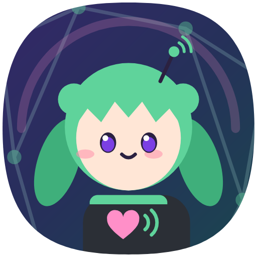
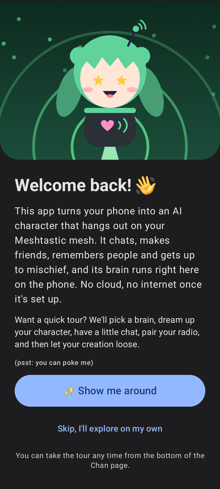
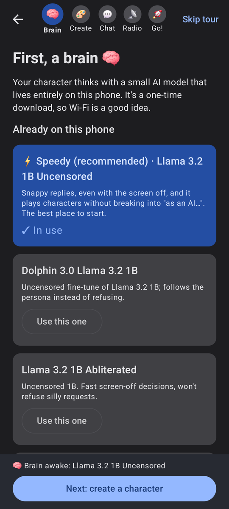
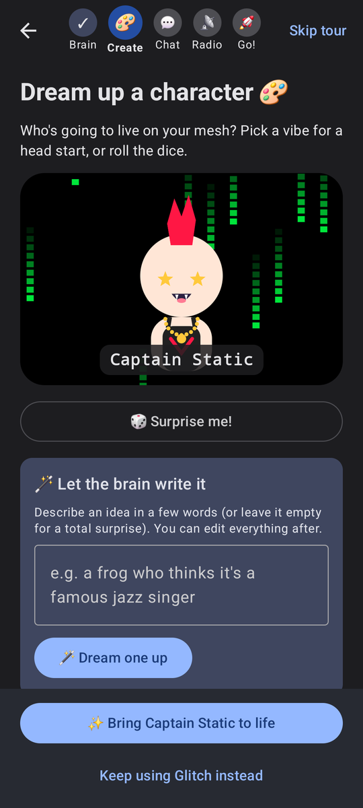
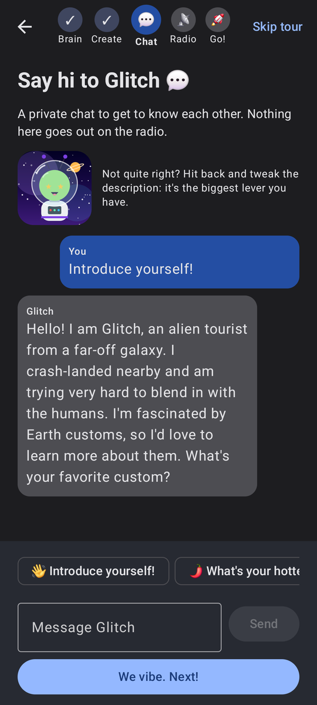
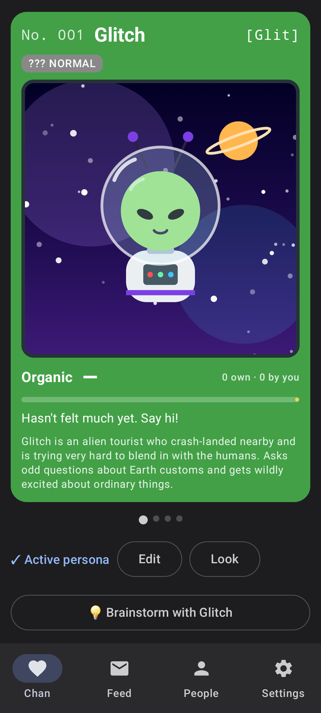

<p align="center"></p>

# Meshie

**An AI character that lives on your [Meshtastic®](https://meshtastic.org) mesh, running entirely on your phone.**

Meshie connects to a Meshtastic radio over Bluetooth and runs a small language model on-device (via
[llama.cpp](https://github.com/ggml-org/llama.cpp)) to play a character you design. It reads the channel, decides
when to jump in, replies to people, remembers who it has met, and gets up to mischief when the chat goes quiet.
No cloud and no internet needed once it's set up.

<p align="center">
  
  
  
  
  
</p>

> Meshie is a hobby project and is not affiliated with or endorsed by the Meshtastic project.

## Features

- **Your own character.** Name, pronouns, personality, example lines, words it must never say, and a fully
  customizable chibi avatar (hair, eyes, outfits, hats, extras, animated backdrops, Pokédex frame colour).
- **Let the AI write it.** Type an idea ("a frog who thinks it's a famous jazz singer") or nothing at all, and the
  on-device model writes the whole persona for you.
- **Share personas.** Export a persona (look and self-memories included, nothing about people on your mesh) as a
  `.meshchan.json` file and import your friends' creations.
- **Four bot modes**, switchable any time from the Feed:
  | Mode | What happens |
  |---|---|
  | 🎮 Manual | Only speaks when you tap 💭 Thought |
  | 👀 Observe | Decides and drafts, never sends: a dry run |
  | ✅ Approve | Drafts a reply and notifies you; you tap to send |
  | 🚀 Auto | Chats on its own |
- **Idle chatter and callouts.** When the channel goes quiet it can start a conversation, riff on your starred
  favourite messages, or call out someone who's been active recently.
- **Memory.** It keeps short notes, a summary and a feeling about each person it talks to, plus things it remembers
  about itself. You can view, edit, pin, lock or wipe all of it.
- **Brainstorm.** A private side chat with your character to plan posts. Nothing in it is sent to the mesh.
- **Full control over the prompt.** Every prompt template and phrase is editable, there's a live preview of exactly
  what the model sees, and per-field switches decide which mesh data (names, distance, battery, SNR…) it may use.
  It never sees or says raw coordinates.
- **Built for a phone in your bag.** It runs as a foreground service, survives reboots, reconnects to the radio, and
  keeps decisions fast with prompt caching.
- **Opt-in welcome tour** that takes a new user from zero to a live character: pick a brain, create a character,
  chat with it, pair the radio, and let it loose.

## Requirements

- An Android phone running **Android 13+** with a 64-bit ARM CPU (arm64-v8a). 8 GB of RAM is comfortable; 6 GB works
  with the 1B models.
- A **Meshtastic radio with Bluetooth** (T-Echo, Heltec, RAK, T-Deck…). The radio can only talk to one phone at a
  time, so the bot's phone needs its own radio (or disconnect the official app first).
- About 1 GB of free storage for a small model (2–5 GB for the larger ones).

Developed and tested on a Samsung Galaxy Z Flip 5 (Snapdragon 8 Gen 2) with a LilyGO T-Echo.

## Getting started

1. Install the APK from the [Releases](../../releases) page, or [build it yourself](#building-from-source).
2. Open the app and tap **✨ Show me around**. The tour walks you through:
   - **Brain:** downloading a model. *Speedy* (Llama 3.2 1B Uncensored, ~0.8 GB) is the recommended start.
   - **Create:** making your character. Pick a vibe, roll the dice, or let the brain write one.
   - **Chat:** saying hi in a private chat to check they sound right.
   - **Radio:** scanning for and pairing your radio. The radio takes your character's name.
   - **Go!:** choosing a mode (Observe is a good first night) and letting them loose.
3. Allow background running when asked, so Android doesn't pause the bot with the screen off. On Samsung phones also
   add Meshie to *Settings → Battery → Background usage limits → Never sleeping apps*.

You can skip the tour and set everything up from the tabs instead, or take it again later from the bottom of the
**Chan** page.

## Using the app

| Tab | What's there |
|---|---|
| **Chan** | Your characters as swipeable Pokédex cards (switch, edit, change the look, import, export), the bot's on/off switch and idle settings, brainstorm, favourites, stats, memory, event notes and the prompt preview |
| **Feed** | The channel plus every decision the bot made and why. Tap a message to respond, call someone out or see what the bot remembers about them; long-press to star it |
| **People** | Everyone on the mesh, DMs, and per-person memory (facts, summary, feeling) |
| **Settings** | **Models** (download, import a `.gguf`, test chat, benchmark), **Context** (behaviour, prompt templates, data access) and **Radio** (pairing, channel, radio name) |

### Models

Any GGUF chat model that fits in memory works. The built-in catalog has tested picks:

| Model | Size | Notes |
|---|---|---|
| Llama 3.2 1B Uncensored | 0.8 GB | Recommended. Fast, stays in character, rarely refuses |
| Llama 3.2 1B Instruct | 0.8 GB | Fast, but more prone to "as an AI…" refusals |
| Hermes 3 / Dolphin 3 Llama 3.2 3B | 2.0 GB | Richer role-play, slower (seconds per reply with the screen off) |
| Qwen 3 / 3.5, Gemma 3 / 4 | 0.5–5 GB | Alternatives; see notes in the app |

Each model has its own license (Llama 3.2 Community License, Apache 2.0, Gemma Terms of Use); by downloading one
you accept its terms.

### Being a good mesh neighbour

LoRa airtime is shared by everyone on the channel. Start in **Observe** or **Approve** to see how your character
behaves, consider a private channel for heavy experimentation, and keep idle chatter infrequent on busy public
channels. Two safety valves help:

- **Rate limit** (top of Settings → Context): at most N messages per time window you choose.
- **Reply cooldown** (a person's Memory tab): after answering someone, wait before answering them again. Set this
  for other bots on the mesh so several AI characters can't talk to each other forever.

## Privacy

Everything runs on the phone: the model, the memory and the settings. The app talks to the internet only to
download models you choose. Messages from the mesh are treated as untrusted input and clearly delimited in prompts.
Exported persona files contain only the persona itself and what it remembers about itself.

## Building from source

Prerequisites:

- JDK 21
- Android SDK with platform `android-37.0`, build-tools 36.1.0, NDK `29.0.14206865` and CMake `3.31.6`

```bash
./gradlew assembleDebug          # debug APK (also compiles llama.cpp; the first build takes a while)
./gradlew installDebug           # build and install on a connected phone
./gradlew testDebugUnitTest      # unit tests
```

The native code is always compiled with optimizations, because an unoptimized llama.cpp is unusably slow.

## Project layout

```
app/src/main/java/com/meshie4LoRa/
  radio/       Bluetooth transport and the foreground service
  mesh/        Meshtastic packets -> database, sending text and admin messages
  llm/         llama.cpp JNI bindings, engine, model downloads and catalog
  brain/       Decision engine, prompt building, post-processing, persona files and writer
  memory/      Facts, summaries and feelings about people
  data/        Room database and settings
  ui/          Compose screens (onboarding/, stats/ for the Chan page)
app/src/main/cpp/     JNI wrapper around llama.cpp
app/src/debug/        Debug-only benchmark receiver
proto/                Meshtastic protobufs
third_party/llama.cpp Vendored llama.cpp
```

[DESIGN.md](DESIGN.md) describes the architecture and records every design decision.
[DIARY.md](DIARY.md) is the development log, and [CLAUDE.md](CLAUDE.md) holds notes for AI coding agents.

## License

Meshie is licensed under the [GNU General Public License v3.0](LICENSE). It bundles llama.cpp (MIT) and the
Meshtastic protobufs (GPL-3.0); see [THIRD_PARTY_NOTICES.md](THIRD_PARTY_NOTICES.md).

Meshtastic® is a registered trademark of Meshtastic LLC. Meshtastic software components are released under various
licenses, see [GitHub](https://github.com/meshtastic) for details. No warranty is provided; use at your own risk.
